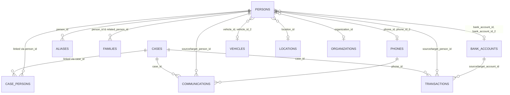

# CNA-SYSTEM — Data Dictionary & Dataset Specification

> **Problem Statement 26189 — AI-Powered Criminal Network Analysis System**  
> **Role:** Member 2 — Data Engineering and Validation  
> **Synthetic Demonstration Data Only** — All entities, relationships, cases, and identifiers are 100% fictional.

---

## 1. Architectural Data Separation

The system maintains strict architectural isolation between four distinct tiers of data:

```
┌────────────────────────────────────────────────────────────────────────┐
│                        DATA ARCHITECTURE                               │
├────────────────────────────────────────────────────────────────────────┤
│ 1. BASELINE DEMO DATA       backend/data/*.csv                         │
│    13 immutable reference tables loaded at startup                     │
├────────────────────────────────────────────────────────────────────────┤
│ 2. RUNTIME DELTA DATA       backend/data/runtime/*.csv                 │
│    Dynamic cases, persons, and links registered during active sessions │
├────────────────────────────────────────────────────────────────────────┤
│ 3. SCALED BENCHMARK DATA    backend/data/expanded/<profile>/*.csv      │
│    Parametric synthetic datasets (SMALL, MEDIUM, LARGE) & stress tests │
├────────────────────────────────────────────────────────────────────────┤
│ 4. GROUND TRUTH DATA        backend/data/ground_truth.csv              │
│    Supervised relationship labels for ML confidence training           │
└────────────────────────────────────────────────────────────────────────┘
```

* **Baseline Demo Data (`backend/data/*.csv`)**: Read-only reference baseline (250 cases, 200 persons). Never overwritten at runtime.
* **Runtime Store (`backend/data/runtime/*.csv`)**: Isolated delta store capturing dynamic case registrations and newly observed persons via `runtime_store.py`. Pre-commit validated.
* **Expanded & Benchmark Data (`backend/data/expanded/`)**: Parametrically generated datasets produced by `modules.data_generator` for topological benchmarking and adversarial robustness evaluation.
* **Ground Truth (`backend/data/ground_truth.csv`)**: Verified positive and negative relationship pairs used strictly for ML training and evaluation; never fabricated or modified to inflate metrics.

---

## 2. Table Specifications & Schemas

### 2.1 `cases.csv` (Investigation Cases)
* **Primary Key:** `case_id` (Pattern: `^CASE-\d{3,}$`)
* **Purpose:** Core investigation incidents and case files.

| Column | Type | Required | Format / Constraint | Description |
| :--- | :--- | :---: | :--- | :--- |
| `case_id` | String | **Yes** | `CASE-XXX` | Unique case identifier |
| `case_title` | String | No | Free text | Descriptive case title |
| `offence_category` | String | **Yes** | Categorical | Crime classification (e.g. Fraud, Kidnapping) |
| `legal_section` | String | No | e.g. `IPC 420`, `IT Act 66C` | Indian legal section code |
| `fir_number` | String | No | e.g. `FIR-SYNTH-XXX-XXXX` | First Information Report number (must be globally unique) |
| `date_opened` | Date | **Yes** | `YYYY-MM-DD` | Date incident file was opened |
| `description` | String | No | Free text | Investigation summary narrative |
| `status` | Enum | **Yes** | `OPEN`, `CLOSED`, `UNDER INVESTIGATION`, `CHARGESHEETED` | Current status of case |
| `police_station` | String | **Yes** | Free text | Jurisdictional police station |
| `district` | String | **Yes** | Indian District name | Jurisdictional district |
| `state` | String | No | Indian State name | Jurisdictional state |
| `location_id` | String | No | Foreign Key -> `locations.csv` | Primary incident location |

---

### 2.2 `persons.csv` (Person Demographic Profiles)
* **Primary Key:** `person_id` (Pattern: `^PERSON-\d{3,}$`)
* **Purpose:** Demographics and master profile for fictional subjects, witnesses, and suspects.

| Column | Type | Required | Format / Constraint | Description |
| :--- | :--- | :---: | :--- | :--- |
| `person_id` | String | **Yes** | `PERSON-XXX` | Unique person identifier |
| `full_name` | String | **Yes** | Free text | Full legal name |
| `first_name` | String | No | Free text | First name component |
| `last_name` | String | No | Free text | Last name component |
| `gender` | Enum | **Yes** | `MALE`, `FEMALE`, `OTHER`, `UNKNOWN` | Biological / reported gender |
| `date_of_birth` | Date | No | `YYYY-MM-DD` | Date of birth |
| `age` | Integer | No | `1 <= age <= 120` | Age in years (must be consistent with DOB) |
| `occupation` | String | No | Free text | Profession or employment |
| `education` | String | No | Free text | Education qualification |
| `address` | String | No | Free text | Residential address |
| `locality` | String | No | Free text | Local neighborhood |
| `city` | String | No | Free text | City of residence |
| `district` | String | **Yes** | Free text | District of residence |
| `state` | String | No | Free text | State of residence |
| `pin_code` | String | No | 6-digit PIN | Postal PIN code |
| `phone_id` | String | No | Foreign Key -> `phones.csv` | Primary registered phone |
| `phone_id_2` | String | No | Foreign Key -> `phones.csv` | Secondary registered phone |
| `bank_account_id` | String | No | Foreign Key -> `bank_accounts.csv` | Primary bank account |
| `bank_account_id_2`| String | No | Foreign Key -> `bank_accounts.csv` | Secondary bank account |
| `vehicle_id` | String | No | Foreign Key -> `vehicles.csv` | Primary registered vehicle |
| `vehicle_id_2` | String | No | Foreign Key -> `vehicles.csv` | Secondary registered vehicle |
| `location_id` | String | No | Foreign Key -> `locations.csv` | Primary associated location |
| `organization_id`| String | No | Foreign Key -> `organizations.csv` | Associated employer/organization |
| `email` | String | No | Email format | Contact email |

---

### 2.3 `phones.csv` (Telecommunications)
* **Primary Key:** `phone_id` (Pattern: `^PHONE-\d{3,}(?:-V\d+)?$`)
* **Entity Resolution Variants:** IDs with `-V1`, `-V2` represent different representations of the same phone.

| Column | Type | Required | Format / Constraint | Description |
| :--- | :--- | :---: | :--- | :--- |
| `phone_id` | String | **Yes** | `PHONE-XXX` or `PHONE-XXX-V#` | Unique device/subscription ID |
| `phone_number` | String | **Yes** | 10 digits, `+91 XXXXXXXXXX`, or `XXXXX-XXXXX` | Standard Indian phone number |
| `phone_type` | Enum | No | `MOBILE`, `LANDLINE`, `VOIP` | Line subscription type |
| `imei` | String | No | 15-digit number | Device hardware identifier |
| `service_provider`| String | No | e.g. Airtel, Jio, BSNL | Telecom service operator |

---

### 2.4 `bank_accounts.csv` (Financial Accounts)
* **Primary Key:** `bank_account_id` (Pattern: `^BANK-\d{3,}(?:-V\d+)?$`)

| Column | Type | Required | Format / Constraint | Description |
| :--- | :--- | :---: | :--- | :--- |
| `bank_account_id` | String | **Yes** | `BANK-XXX` or `BANK-XXX-V#` | Unique account record ID |
| `account_number` | String | **Yes** | 9 to 18 digits or masked format | Bank account number |
| `bank_name` | String | **Yes** | Free text | Financial institution name |
| `ifsc_code` | String | No | 11-character alphanumeric | Indian Financial System Code |
| `branch` | String | No | Free text | Branch locality |

---

### 2.5 `vehicles.csv` (Vehicles)
* **Primary Key:** `vehicle_id` (Pattern: `^VEHICLE-\d{3,}(?:-V\d+)?$`)

| Column | Type | Required | Format / Constraint | Description |
| :--- | :--- | :---: | :--- | :--- |
| `vehicle_id` | String | **Yes** | `VEHICLE-XXX` or `VEHICLE-XXX-V#` | Unique vehicle record ID |
| `registration_number`| String | **Yes** | Indian plate format (e.g. `WB89DD2874`, `MH-71-MV-5397`) | Vehicle registration number |
| `vehicle_type` | Enum | **Yes** | `CAR`, `VAN`, `MOTORCYCLE`, `TRUCK`, `AUTO-RICKSHAW`, `SUV` | Vehicle category |
| `model` | String | No | Free text | Manufacturer model |
| `color` | String | No | Free text | Exterior color |

---

### 2.6 `locations.csv` (Geographical Nodes)
* **Primary Key:** `location_id` (Pattern: `^LOCATION-\d{3,}$`)

| Column | Type | Required | Format / Constraint | Description |
| :--- | :--- | :---: | :--- | :--- |
| `location_id` | String | **Yes** | `LOCATION-XXX` | Unique location identifier |
| `city` | String | **Yes** | Free text | City name |
| `district` | String | **Yes** | Free text | District name |
| `state` | String | **Yes** | Free text | State name |
| `pincode` | String | No | 6-digit PIN | Postal PIN code |
| `police_station`| String | No | Free text | Nearest police station |

---

### 2.7 `organizations.csv` (Entities & Businesses)
* **Primary Key:** `organization_id` (Pattern: `^ORG-\d{3,}$`)

| Column | Type | Required | Format / Constraint | Description |
| :--- | :--- | :---: | :--- | :--- |
| `organization_id` | String | **Yes** | `ORG-XXX` | Unique organization identifier |
| `organization_name`| String | **Yes** | Free text | Registered commercial or entity name |
| `organization_type`| String | No | e.g. Logistics, Finance, Shell | Business sector or type |
| `registration_number`| String | No | Alphanumeric | CIN or corporate registration number |

---

### 2.8 `aliases.csv` (Alias & Street Names)
* **Primary Key:** `alias_id` (Pattern: `^ALIAS-\d{3,}$`)

| Column | Type | Required | Format / Constraint | Description |
| :--- | :--- | :---: | :--- | :--- |
| `alias_id` | String | **Yes** | `ALIAS-XXX` | Unique alias record identifier |
| `person_id` | String | **Yes** | Foreign Key -> `persons.csv` | Reference to person |
| `alias_name` | String | **Yes** | Free text | Alias, nickname, or moniker |
| `context` | String | No | Free text | Circumstances of alias usage |

---

### 2.9 `families.csv` (Kinship & Family Relations)
* **Primary Key:** `family_id` (Pattern: `^FAM-\d{3,}$`)

| Column | Type | Required | Format / Constraint | Description |
| :--- | :--- | :---: | :--- | :--- |
| `family_id` | String | **Yes** | `FAM-XXX` | Unique family link record ID |
| `person_id` | String | **Yes** | Foreign Key -> `persons.csv` | Subject person ID |
| `related_person_id`| String | **Yes** | Foreign Key -> `persons.csv` | Relative person ID |
| `relationship_subtype`| Enum | **Yes** | `FATHER`, `MOTHER`, `SPOUSE`, `BROTHER`, `SISTER`, `CHILD` | Specific family relationship |

> **Graph Safety Rule:** Family relationships are strictly kinship ties and are never added as criminal graph edges.

---

### 2.10 `case_persons.csv` (Case-Person Associations)
* **Primary Key:** `cp_id` (Pattern: `^CP-[A-Za-z0-9_-]+$` or `^CPA-\d{4,}$`)
* **Source Provenance:** Encodes `CP-<case_id>-<person_id>` for deterministic record lineage.

| Column | Type | Required | Format / Constraint | Description |
| :--- | :--- | :---: | :--- | :--- |
| `cp_id` | String | **Yes** | Unique association ID | Provenance identifier |
| `case_id` | String | **Yes** | Foreign Key -> `cases.csv` | Associated case ID |
| `person_id` | String | **Yes** | Foreign Key -> `persons.csv` | Associated person ID |
| `role` | Enum | **Yes** | `ACCUSED`, `SUSPECT`, `WITNESS`, `VICTIM`, `INFORMANT`, `SUBJECT` | Role in investigation |
| `narrative` | String | No | Free text | Investigative role details |
| `created_at` | DateTime | No | ISO-8601 | Record creation timestamp |
| `created_by` | String | No | Free text | User/officer username |

---

### 2.11 `communications.csv` (Call & Message Records)
* **Primary Key:** `communication_id` (Pattern: `^COMM-\d{3,}$`)

| Column | Type | Required | Format / Constraint | Description |
| :--- | :--- | :---: | :--- | :--- |
| `communication_id`| String | **Yes** | `COMM-XXX` | Unique communication log ID |
| `case_id` | String | **Yes** | Foreign Key -> `cases.csv` | Context case identifier |
| `source_person_id`| String | **Yes** | Foreign Key -> `persons.csv` | Originating party |
| `target_person_id`| String | **Yes** | Foreign Key -> `persons.csv` | Receiving party |
| `phone_id` | String | No | Foreign Key -> `phones.csv` | Device or number used |
| `communication_type`| Enum | No | `CALL`, `SMS`, `CHAT` | Transmission channel |
| `description` | String | **Yes** | Human-readable text | Narrative log parsed by NLP pipeline |

---

### 2.12 `transactions.csv` (Financial Transactions)
* **Primary Key:** `transaction_id` (Pattern: `^TXN-\d{3,}$`)

| Column | Type | Required | Format / Constraint | Description |
| :--- | :--- | :---: | :--- | :--- |
| `transaction_id` | String | **Yes** | `TXN-XXX` | Unique transaction ID |
| `case_id` | String | **Yes** | Foreign Key -> `cases.csv` | Related case identifier |
| `source_person_id`| String | **Yes** | Foreign Key -> `persons.csv` | Remitting person |
| `target_person_id`| String | **Yes** | Foreign Key -> `persons.csv` | Beneficiary person |
| `source_account_id`| String | No | Foreign Key -> `bank_accounts.csv` | Debited account |
| `target_account_id`| String | No | Foreign Key -> `bank_accounts.csv` | Credited account |
| `amount` | Numeric | **Yes** | Positive float/int (`> 0`) | Transaction value in INR |
| `date` | Date | No | `YYYY-MM-DD` | Date of financial transfer |
| `description` | String | No | Free text | Financial narrative |

---

### 2.13 `ground_truth.csv` (Supervised Relationship Evaluation)
* **Primary Key:** `ground_truth_id` (Pattern: `^GT-\d{3,}$`)

| Column | Type | Required | Format / Constraint | Description |
| :--- | :--- | :---: | :--- | :--- |
| `ground_truth_id` | String | **Yes** | `GT-XXX` | Unique ground-truth identifier |
| `source_entity_id`| String | **Yes** | Entity ID | Source entity (`PERSON-XXX`, `CASE-XXX`, etc.) |
| `target_entity_id`| String | **Yes** | Entity ID | Target entity |
| `relationship_type`| Enum | **Yes** | Standard relationship enums | Relationship type |
| `expected_relationship`| Flag | **Yes** | `1` (True Positive) or `0` (Hard Negative) | Supervised label for confidence model |
| `case_id` | String | No | Foreign Key -> `cases.csv` | Context case |
| `evidence_reference`| String | No | CSV filename or document tag | Source provenance document |

---

## 3. Entity Relationships Diagram (Foreign Keys)



---

## 4. Source Provenance Policy

Every analytical node and edge in the knowledge graph must trace back to verifiable synthetic records.
* **Nodes:** Every node must maintain a `source` tag (`SYNTHETIC_ID`, `STRUCTURED_METADATA`, or `NLP_EXTRACTION`).
* **Edges:** Every relationship edge must preserve `record_ids` referencing the primary key of the originating row (`communication_id`, `transaction_id`, or `cp_id`).
* **Runtime Registrations:** Must preserve `created_at` (ISO timestamp) and `created_by` (authorized officer username).
